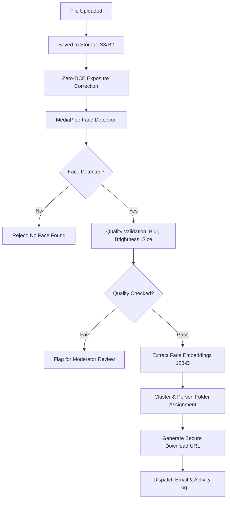

# FaceCloud — AI Facial Image Enhancement & Identity Organization Platform

FaceCloud is an AI-powered web application for enhancing, validating, organizing, and monitoring facial images. It allows users to upload images, process them through an AI pipeline, group detected faces into person folders, and download enhanced results. It also includes admin monitoring and moderator review workflows.

Powered by **DATAMART / DTM.IO**.

---

## 1. Project Overview

FaceCloud is designed to handle high-throughput and low-light facial photography, providing tools for both regular users, moderators, and system administrators. The key features of the platform include:
* **AI Facial Image Enhancement**: Automatically enhances exposure, contrast, and facial details on uploaded portraits.
* **Zero-DCE (Zero-Reference Deep Curve Estimation)**: Conceptually used for low-light enhancement without reference images, restoring details in dark zones.
* **Face Detection & Landmarks**: Uses on-device machine learning to locate faces and identify landmark coordinates.
* **Quality Validation**: Automatically checks images for quality criteria including brightness, blur, and face size ratio.
* **Person Folder Grouping (Identity Groups)**: Clusters detected face embeddings, mapping identical faces to unique person folders automatically.
* **Secure Downloads**: Generates time-limited download links for single images or complete batch reports.
* **Processing Jobs**: Monitored queues that track multi-stage backend operations in real-time.
* **Admin Monitoring**: Dashboards tracking user directory, security incidents, API endpoint test runners, and statistics.
* **Moderator Review**: A manual human-in-the-loop review queue for borderline or rejected images.
* **Mock Architecture**: The frontend is fully functional and uses LocalStorage/mock presets to simulate API responses.

---

## 2. Current Frontend Status

The frontend is being connected to the [Django backend](https://github.com/ijaz-student021/FaceCloud_backend) one screen at a time, controlled by `VITE_USE_API` in `.env.local`:

* **Live on the API:** sign-in; the moderator dashboard and review queue; and the user portal's single upload, processing view, uploads list, My Images gallery and image detail.
* **Still on browser filters only:** the live webcam preview (captured frames are enhanced by the real pipeline). Every other screen in the user portal, the admin console and the moderator panel reads the live API when `VITE_USE_API=true`, and keeps its demo data otherwise.

With `VITE_USE_API=false` (or no `VITE_API_URL`) every screen falls back to the built-in demo data, so the prototype stays fully browsable without a server running.

**Local backend and batch progress:** the Upload Multiple / ZIP screens show each stage (checking faces, quality, grouping, enhancing) only when the backend hands the work to a Celery worker. With `DJANGO_DEBUG=True` and no `CELERY_TASK_ALWAYS_EAGER=False`, the backend does all the processing *inside the upload request*: the screen then sits on "Uploading…" and jumps straight to the finished result. For the real behaviour run Redis, set `CELERY_TASK_ALWAYS_EAGER=False` in the backend `.env`, and start `celery -A config worker -l info --pool=solo` next to the API (`--pool=solo` is needed on macOS).

---

## 3. Tech Stack

The application relies on the following frontend dependencies (from [package.json](file:///Users/Ali/Downloads/FYP/package.json)):
* **Framework**: React (v19.2.7)
* **Build System & Dev Server**: Vite (v8.1.1)
* **Language**: TypeScript
* **Styling**: Tailwind CSS (v3.4.19)
* **Animation**: Framer Motion (v12.42.2)
* **Icons**: Lucide React
* **Data Visualization**: Recharts (v3.9.2)
* **Video Hero Stream**: hls.js (v1.6.16) for responsive video playback
* **On-Device Machine Learning**: `@mediapipe/tasks-vision` (v0.10.35) for browser webcam face detection
* **Routing**: React Router DOM (v7.18.1)
* **Mock State Management**: LocalStorage-backed mock session store

---

## 4. Design System / UI Theme

FaceCloud uses a **Cinematic Dark Liquid-Glass UI** aesthetic:
* **Background**: Pure dark palette (`#000000` primary background).
* **Glassmorphism**: Backdrop blur panels (`backdrop-filter: blur(24px)`) styled with subtle border stroke overlays (`rgba(249, 115, 22, 0.12)`).
* **Color Accents**: Premium orange brand accents (`#F97316` core accent, with `#EA580C` and `#FB923C` stops). Status colors (Emerald, Amber, Rose) are preserved for active success/warning/error states.
* **Typography**: Primary display headings (`h1`, `h2`, `h3`) utilize `Space Mono` (Google Fonts). Small numbered section indicators utilize `Silkscreen` (Google Fonts). Body copy continues using `Inter`.
* **Visual Effects**: Micro-animations on buttons and cards using Framer Motion, dynamic hover transitions, and pulse glows on status badges.
* **Landing Page**: The FaceCloud hero plays one seamless looping background video (`public/videos/facecloud-hero-sunset.mp4` and its poster `facecloud-hero-sunset-poster.jpg`: the footage's last second is blended into its first, baked with ffmpeg, so it neither jumps nor plays backwards; the same in both appearances; played at 0.7x, still when the cursor moves; people who ask for reduced motion get the still poster). The earlier forward / reverse cuts of the dark portrait are still in `public/videos/` but no longer used. Features a "live systems" data-ops aesthetic with status badges, terminal-style logs, live pipeline cards, and animated percentage indicators.
* **Responsive Layouts**: a "glassy" shell — a floating icon rail on the left (each icon names itself on hover; a labelled drawer on phones; it always starts under the top bar, and its icons shrink with the screen's height so even the administrator's 16 icons fit), a floating top bar, a floating bottom navigation pill with every section by name (scrolling sideways; for a member it ends in a **+** that opens the upload popup over the current page), and one glass stage sheet that holds each page — on a warm, softly lit "room" ground, in both the dark and the light appearance. On the home page the hero and the Control section follow the appearance too: the hero plays a light cut of the footage (the black ground replaced by the page's cream) in the light appearance and the original in the dark one. The bars are "liquid glass" (thick blur, sheen and rim light) and the current section sits under a lens that springs to the next one on a route change and can be dragged along the pill and released with momentum.

### Landing Page Sections (in order)
1. **Fullscreen Video Hero** — self-hosted MP4 background video (one seamless crossfaded loop, `facecloud-hero-sunset.mp4`, played at 0.7x; the cursor does not move or zoom it), staggered headline animation with `<ScrambleText>` decodes and orange highlight blocks, inline email waitlist capture, pill badge pop-in.
2. **Trusted Logos Marquee** — Infinite horizontal scroll of partner logos.
3. **Stats / Metrics Bar** — 4 animated CountUp counters (detection accuracy, processing time, images processed, RBAC roles).
4. **01 / Early Access Feedback** — Testimonials block with orange hover border shadows.
5. **02 / Dataset Challenge (Problem Cards)** — 5 problem cards with staggered scroll reveal and icon pop animations.
6. **03 / Use Cases / Who It's For** — 4 cards: Identity Verification, Event Photography, HR & Onboarding, Enterprise Photo Archives.
7. **04 / AI Infrastructure** — Live-looping pipeline panel cycling PENDING → ACTIVE → SUCCESS status badges.
8. **05 / Ingestion Suite** — 12-card feature grid with staggered reveal and hover glow.
9. **06 / Methodology (Freedom Section)** — Responsive three-column layout with an HLS-hosted processing video, pain points list, and benefits list.
10. **07 / Interactive Demo** — Before/after slider with auto-demo scroll trigger (0→50%).
11. **Gallery** (`src/components/landing/GallerySection.tsx`, photos in `public/gallery/`) — 26 portraits in very different light (evening, studio, window, neon, coloured gels, black & white, hard sun, silhouette, motion blur…) share one pool, and **six are on show in justified rows**: two rows of three on a desktop, three of two on a tablet, three stacked on a phone. A row is always the same height and its photos share the width in proportion to their shape (a narrow portrait next to wide close-ups), so nothing on the page moves; a photo is cropped a little around its face when its row is not exactly its shape and is shown whole in the viewer. **Every 4 seconds two of the six are swapped for two that were not on show**, chosen at random and never one that has just left, and the neighbours in the row glide to their new widths. A thin progress bar under the grid is the timer itself (it loops every 4 s and the update happens each time it is full), with a pause/play button beside it. Updates also pause while the pointer or keyboard focus is on the grid and while the full-screen viewer is open; with *reduce motion* set there is no automatic change and a "Show other photos" button instead. Photos are fetched once, just before the gallery scrolls into view, and only photos already fetched are brought in. Hover or keyboard focus shows a caption; a click opens the viewer (arrow buttons or keys, drag/flick to turn the page, Escape to close, focus returned to the photo, background scroll locked). The captions describe the photographs; they do not claim FaceCloud processed them. To add a photo: put `gallery-NN.webp` (1800 px) and `gallery-NN-sm.webp` (1000 px), without metadata, in `public/gallery/` and add one line to `PHOTOS`.
12. **08 / Processing Options** — Single, Multiple, ZIP upload cards.
13. **09 / Pricing** — Monthly/Yearly toggle, 3 tier cards (Free/Basic/Pro), each marked "Coming soon" with a disabled button — plans and pricing are deferred to V2.
14. **10 / User Interface** — 3 dashboard preview mockup cards.
15. **11 / Administrative Control** — Admin Console and Moderator Review cards with orange-colored hover glows.
16. **12 / Enterprise Security** — Security points grid + animated terminal log feed with typewriter effect.
17. **13 / FAQ** — Accordion with Framer Motion layout height animation.
18. **14 / API / Integrations Teaser** — Terminal-style code block showing example REST request.
19. **Final CTA** — Call to action with orange gradient orb background.
20. **Footer** — Logo, Product links (Features, Methodology, Pricing, Security, FAQ), Company (About Us, Moderator Role & Plans, Contact), Portals (Login, Create Account), Compliance. Above it on every public page: **Explore FaceCloud**, four link cards to the other public pages.

### Public Marketing Pages
* **About Page (`/about`)**: Full-width marketing overview highlighting the product genesis and core mission:
  * **Hero Section**: Mission badge and first-person-plural story explaining *why* FaceCloud was built.
  * **Mission Statement**: Explains FaceCloud's approach to the Dataset Challenge.
  * **How We Work**: Three card-based value pillars (Automation with Control, Security, and Production-tested building in partnership with DataMart).
  * **Ownership** (eyebrow "The Founders"): the two owners, each with a picture on FaceCloud's orange (`public/team/`), role, place, a title where one is given, and a LinkedIn link: **Valentyn P.** (Founder & Owner, the main owner, highlighted, no title line) and **Muhammad Asif** (Co-Owner, CEO of Datamart). Below them two teams in the same card style, smaller: **Development Team**: Ali Hassan (Frontend & UI/UX Lead), Ijaz Ahmad (Backend Engineer), Vaneeza Sohaib (Computer Vision Engineer, initials on orange: no picture on her profile); **Marketing Team**: Kamal Ahmad (Head of Marketing), Athar Ammar (Business Development Manager, Los Angeles), Ali Awan (Head of Sales). One `PersonCard` draws every card. The earlier placeholder team cards are gone.
* **Contact Page (`/contact`)**: Centered contact hub containing:
  - **Header**: Inline badge and workflow question subtext.
  - **Inquiry Form**: Interactive layout capturing Name, Email, optional Company, select inquiry Reason, and Message. Includes real-time validation, dynamic error labels, asynchronous submission status overlays (processing state, success state, retry error state), and console-logged JSON payload stub.
  - **Context Info Cards**: Displays general support email, enterprise partnerships channel, and quick FAQ anchor redirection back to the home page.

### Animation Utility Components
* [`RevealOnScroll`](file:///Users/Ali/Downloads/FYP/src/components/animation/RevealOnScroll.tsx) — `whileInView` scroll-triggered reveal with direction, delay, and `prefers-reduced-motion` support.
* [`StaggerChildren`](file:///Users/Ali/Downloads/FYP/src/components/animation/StaggerChildren.tsx) — Container + item wrapper for staggered child animations.
* [`CountUp`](file:///Users/Ali/Downloads/FYP/src/components/animation/CountUp.tsx) — Animated number counter with easeOutQuart easing, triggered on scroll.
* [`ScrambleText`](file:///Users/Ali/Downloads/FYP/src/components/animation/ScrambleText.tsx) — Animated scroll-to-view text scramble-and-decode component with custom frames duration and prefers-reduced-motion bypass support.

---

## 5. Authentication and Roles

The application protects routes based on user roles using a [ProtectedRoute](file:///Users/Ali/Downloads/FYP/src/components/layout/ProtectedRoute.tsx) guard checked against `localStorage`.

### Mock Credentials

| Role | Username | Password | Purpose |
| :--- | :--- | :--- | :--- |
| **User** | `user@facecloud.ai` | `password` | Uploading, managing images, viewing folders, and webcam live demo. |
| **Admin** | `admin@dtm.io` | `password` | Auditing logs, managing users, testing mock APIs, system health panels. |
| **Moderator** | `moderator@facecloud.ai` | `password` | Checking flagged images, reviewing rejection reasons, approving queues. |

The sign-in pages do not pre-fill or reveal these (a wrong attempt says only "Invalid email or password."); this table is the only place they are written down.

### Auth System Architecture
* **User Login**: Simulates credentials verification and sets the `facecloud_session` JSON item in `localStorage`.
* **Verification Flow**: Localized mock verification redirects users to verify email screen before dashboard entry.
* **Route Protection**: If the session is missing, users are redirected back to the role-specific login. If roles mismatch, they are sent to `/unauthorized`.

---

## 6. Routes

The complete route configuration as specified in [App.tsx](file:///Users/Ali/Downloads/FYP/src/App.tsx):

### Public / Auth Routes
* `/` (Landing Page)
* `/about`, `/contact` (public pages)
* `/roles/moderator` (Moderator role guide — what the role can and cannot do, how a review works, build status, and a **Plans** section (Team $29/mo and Business $79/mo with seat, storage and image limits, "Coming soon"; Enterprise with no limits, "Contact us"; display only, there is no billing); an information page, not the portal; linked from the navbar as "Moderator" and from the Moderator Review card on the landing page; ends with a **Moderator FAQ** of six questions, with FAQPage structured data)
* `/login` (User Login: the field takes an email address or a username; for user accounts only; an admin or moderator account is refused here and signs in on its own page)
* `/register?invitation=<token>` (the same page, opened from an organization invitation: the invited email is locked and one step creates the account and joins the organization; for an **owner** invitation the account becomes the organization's owner and opens `/dashboard/organization`)
* `/register` (User Registration — full name, email, password; creates a real pending account when `VITE_USE_API=true`. It is always a **personal** account (its own private workspace only); it never joins an organization, even when the address has a pending invitation: only accepting an invitation link does)
* `/signup` (Redirects to `/register`)
* `/verify-email` (Email verification. With the API on it opens from the emailed link `/verify-email?registration_id=…&token=…`, confirms it with the backend, then sends the person to `/login`; the demo build keeps a mock button)
* `/forgot-password` (request a reset link by email; linked from all three sign-in pages)
* `/reset-password/:uid/:token` (the page the emailed reset link opens: choose a new password)
* `/verify-email-change/:uid/:token` (the page the link emailed to a NEW address opens after the email was changed; it asks the server once as it opens (`GET /api/auth/verify-email/change/{uid}/{token}/`, 10 an hour) and shows: "Your email address is confirmed" (also when the server says it was already confirmed, a used link), "This link is no longer valid" (400), "Too many tries" (429, the server's wait) or "Couldn't confirm your email address" (network, with Try again). The button goes to `/login`. Needs the mail to link to the frontend address (`{FRONTEND_URL}/verify-email-change/<uid>/<token>`); until then the mail links to the backend and shows raw JSON. An account whose email was just changed cannot sign in until this succeeds)
* `/admin/login` (Admin Console Login: email address or username; admin accounts only; reached by direct link)
* `/moderator/login` (Moderator Panel Login: email address or username; moderator accounts only; reached by direct link)
* `/invitations/:token` (the page an organization invitation email opens: shows who invited you and the role (owner, moderator or member). Signed in with the invited address: an explicit **Accept** (an owner then goes to My Organization). Not signed in: **Sign in** returns here through `/login?next=…` (only an invitation or `/dashboard` address is followed), or **Create account** registers from the invitation. Signed in as someone else: asked to sign in with the invited address. Needs the live backend)
* `/accept-invitation?token=…` (the page an administrator's account invitation email opens, from Admin → Invitations: shows the invited email, the role in words ("Moderator for <organization>", "Administrator", "User") and the expiry, and lets the person choose a username and password; the server judges the password and its messages appear under the fields. It signs nobody in: it says "Account created" and offers the sign-in page of that account's own portal (`/login`, `/moderator/login` or `/admin/login`). The token is removed from the address bar after it is read. A wrong, used, cancelled or expired link shows the server's one sentence; needs the live backend. Not the same as `/invitations/:token`, which joins an organization)
* `/unauthorized` (Access Denied page)
* `*` (Not Found / 404 page)

### User Portal Routes (under `/dashboard`)
* `/dashboard` (User Dashboard Overview)
* `/dashboard/upload` (Upload Center Gateway)
* `/dashboard/upload/single` (Single Image Upload and AI comparison; the review step has an **Enhancement** choice (Auto / Pro, default Auto; Standard and the Lighting choice were removed from the screens on 2026-11-23, the engine decides the lighting and `lighting` is always `auto`), here, on the multiple and ZIP screens and in the upload popup. The choice is sent WITH the upload as the (level, style) pair of the preset and `lighting` (a field is sent only when it is not the default: Standard sends `level=high`, Pro `level=high` and `style=ai_max`, Dark photo `lighting=dark`, Auto with Auto sends nothing) and the backend's own pipeline (checks, enhancement, person folders) does the work; the upload no longer sends `auto_enhance=false`. The result says which preset was used and shows the processing summary, and says once when the server did not use the choice; a photo the backend has already enhanced shows that enhancement's before/after and download instead of starting another; the batch and ZIP screens count such photos as accepted; the result card says a photo that already carries an enhancement status (`pending`, `queued`, `processing`, `completed`, `partial`, `failed`) was accepted, and names a moderator only for a photo sent to a team that the checks were unsure about)
* `/dashboard/upload/multiple` (up to 10 photos in one batch, the steps it is going through, real per-photo verdicts, why the others were not accepted, an Enhancement section with "Enhance accepted photos", and Download Accepted as a ZIP)
* `/dashboard/upload/zip` (a ZIP up to 2 GB holding at most 20 photos: the screen reads the archive's table of contents in the browser and refuses a bigger one before anything is sent, and shows "N photos inside" for an accepted one; the real processing steps while it runs; real counts; "Why some photos were not accepted" in plain words with the photos behind each reason; an Enhancement section that says how many accepted photos are enhanced and has "Enhance accepted photos"; Download Accepted Photos as a ZIP)
* `/dashboard/processing/:id` (Real-time single job processing tracker; once the upload has finished it opens on a Results card: each photo with its picture (an Original / Enhanced switch; the enhanced file is fetched at once for a single photo and only when asked for a batch) and its "What was done" report, or the reason a photo was refused or has not been enhanced; the stages are listed in the order the server sends in the progress payload's `stage_order` (the single-upload screen and the batch screens do the same), and in the built-in order while the server does not send one; see `qa/PROMPT_FOR_BACKEND_PIPELINE_ORDER.md`)
* `/dashboard/images` (My Images gallery; each card shows the photo's latest enhanced picture (the original when it has none) under a title made of the people in it and its upload time, e.g. "Ali Hassan · Nov 21, 2026, 12:46 PM" (the file name is the tooltip); click a photo to open it; a photo an administrator or a moderator rejected is shown as Rejected, not Completed, and is not listed under Accepted; a heart on every photo; tick photos to heart them, add them to an album, group them by person or move them to the trash. The same list serves every way of looking at the library through its address: `?favorite=true`, `?album=`, `?place=`, `?country=`, `?person=` (repeat it for photos with all those people), `?taken_from=` / `?taken_to=`, shown as removable chips)
* `/dashboard/albums` and `/dashboard/albums/:id` (Albums: make, rename, describe and delete albums; an album's photos, add photos from the library, remove them (they stay in the library), choose or reset the cover)
* `/dashboard/trash` (Trash: deleted photos wait here with their days left; Put back, Delete forever (one by one, after a confirmation), Empty trash)
* `/dashboard/duplicates` (Duplicates: one card per pair of photos the duplicate check thinks are the same, the two photos side by side (each opens its photo page), the kind of match ("The same file", "Almost the same photo", "The same face"), how alike, and the decision. Filters: To review / Confirmed / Not duplicates, newest first, 10 to a page. "Same photo" and "Not a duplicate" update the card in place and say what happened; an identical file (an exact match, already confirmed by the server) offers no dismiss. Deciding never deletes or moves anything; "Move one copy to trash…" on a confirmed pair is a separate step that asks which copy and confirms. The page reads the server's own list of matches (`GET /api/duplicates/matches/`, filtered by decision, 100 a page, dismissed pairs included); the three filters show their counts. The photo page's notice shows each match's decision and links here)
* `/dashboard/places` (retired 2026-11-23: redirects to My Images; the Places page, the Places tab, the place filter and the photo's location card were removed from the frontend)
* `/dashboard/moments`, `/dashboard/moments/memories/:id`, `/dashboard/moments/events/:id` (Memories (a few of the best photos of a moment) and Events (photos grouped by the silence between them, with a gap choice))
* `/dashboard/search?q=` (everything that matches a word: photos by name and, when the server has it on, by what is in them, people, albums, folders and uploads; and Search by a face (a photo of someone, needs face consent; the photo is not stored). The top-bar search ends with "See all results")
* `/dashboard/images/:id` (Image Detail: the verdict and quality scores, an Enhanced version card with before/after, Enhance / Enhance again with a style, a strength (the lighting choice was removed 2026-11-23) and, on the result, a "Dark-photo method" or "Light-photo method" badge (from what the backend detected, or what it used when a person can force it; "chosen by you" when forced; "seen as dark, but brightening was not safe to apply" when it was not brightened; older results show none), Download, Edit photo, Download report, a notice when it looks like another photo (the match is shown as a percentage, 100% alike for an identical file), and Move to trash). Also on this page: a heart, Add to album, Compare styles, Look for duplicates again, Run the checks again, and the optional AI advisor when the server has it on (it asks for its own permission first)). The "The photo" card shows, and its main button downloads, the enhanced (or edited) photo: the same picture the slider shows as "after"; "Download the original" is a secondary button (with a download icon, like "Download report") beside it, and when nothing needed fixing the button keeps its old wording "Download the full photo")
* `/dashboard/images/:id/compare` (Compare styles: one photo through the plain filter and the three styles side by side with score and time and a recommended one; Preview each at a large size (arrow keys step through them), Download each, "Use this style at full size", the CSV report, delete the comparison)
* `/dashboard/images/:id/edit` (Photo editor on the live backend: server-rendered previews while the sliders move (brightness, contrast, shadows, highlights, saturation, warmth, sharpness, AI tools, blend), Auto fixes, Reset, Hold to compare, Save as a new full-size version, and the list of versions with Use / Download / Delete. Needs a finished enhancement; not part of the demo build)
* `/dashboard/groups` (Person Folders: with the API on, your real folders with a mosaic of their photos; the consent banner appears here when face grouping is off)
* `/dashboard/groups/history` (what was renamed, merged, moved or decided in the person folders)
* `/dashboard/groups/review` (Review matches: the photos the face grouping was not sure about, each with the suggested folder and match percent; say yes, a different person (existing or new folder), or leave the face out)
* `/dashboard/groups/:id` (one Person Folder: its photos (click a photo to open it; tick the box on its corner to select it), rename, Move selected photos to the trash, Delete empty folder, Delete folder but keep its photos, move a photo to another folder, take it out, make it the folder cover, Merge folder (move another folder's photos into this one), Download All / Download Selected as a ZIP, and a time-limited Secure Link to the whole folder's ZIP)
* `/dashboard/downloads` (real download history; "Your secure links" lists every link made, how often it was opened, and lets you stop one; a new line is added each time a file is downloaded; time-limited secure links for enhanced photos and Person Folder ZIPs; expired batch ZIPs can be prepared again)
* `/dashboard/notifications` (real notifications: mark read / mark all read, open, dismiss, paging; the top-bar bell shows the same unread count)
* `/dashboard/activity` (your real activity history, paged; picking a type chip or searching looks through your newest 500 events (the backend's window) and shows how many of each type there are, or says there are none)
* `/dashboard/settings` (name, organization, job title, phone, country and the picture saved to the account; Delete my account (password and a typed word); password change; the list of signed-in devices with Revoke, and sign out of all devices; notification switches saved to the account. Against a backend that predates profile details/sessions (before backend PR #67) the extras and picture stay on this device and the device list is hidden)
* `/dashboard/enhance` (retired: redirects to `/dashboard/upload`. Auto and Pro are chosen on the Upload screens themselves; see section "Choosing Auto, Standard or Pro")
* `/dashboard/live-enhancement` (webcam preview with face detection; a captured frame is stored in My Images and enhanced by the real pipeline with a chosen style and strength, real before/after and "what was done"; "Enhance again" re-enhances the same photo. The live preview itself uses simple browser filters. The demo build keeps the simulated version)
* `/dashboard/jobs` (Batch job history directory)

> **Sessions:** the user dashboard, the admin console and the moderator panel each keep their own session and tokens (`facecloud_session:<portal>`, `facecloud_refresh:<portal>`), so all three can be signed in side by side in one browser and each signs out on its own.

### Admin Console Routes (under `/admin`)
* `/admin` (Admin Overview: totals, uploads, enhanced, rejected, quality pass rate, storage, with 7 / 30 / 90-day chips)
* `/admin/users` (User directory with server search and paging, upload counts, suspend / activate, Add User. **Account type**: a column and filters *All accounts / Personal only / Personal + Organization(s)* (`?account_type=`; an organization account keeps its personal workspace, so it reads "Personal + N Organization(s)"); **Details**: every workspace of the account (the private one marked as such), photos and storage; **Reset password** e-mails the person a link (nothing secret is shown). Add User e-mails a link to choose a password by default; setting one by hand is still possible. **Moderator reason (backend PR #176):** making someone a moderator here (Add User with role Moderator, Create moderator, or a moderator invitation) needs a **Reason for Moderator Assignment** of at least 8 characters, sent as `reason` and recorded in the organization's audit trail (`admin_moderator_override`), which its owner can read; ordinary users need none.)
* `/admin/audit-logs` (Paged audit trail: actor, role, status, message, resource, sign-in address)
* `/admin/security` (Alerts for repeated failed sign-ins, refused requests and rate limits, with an Acknowledge action that needs a note, and the rules behind them)
* `/admin/privacy` (Privacy Audit, administrators only, from `GET /api/privacy/audit/`: four cards, Consent (is it required, the policy version, people with active / withdrawn / older-version consent), Requests in the last 30 days (a table of each kind with its completed and failed counts, and the number of erasures and retention purges not verified as complete), Retention and temporary files (the limit, the last purge as a table of whatever keys the server sends, stale temporary archives, orphaned media), Encryption (whether uploaded photos are encrypted at rest, the identity-data sentence, key ids, the stored identity records as a table); "Generated" time and a Refresh button. Totals only, no personal data. Bad news is said plainly ("Uploaded photos are not encrypted at rest.", unverified erasures flagged as needing attention) and a "Needs attention" panel collects it. A moderator or a user who opens the address is sent to the administrator sign-in; the server answers them 403)
* `/admin/organizations` (Shared organizations (`?kind=organization`; personal workspaces on request). **New organization**: Organization name, **Owner email**, Subscription plan, *Create Organization & Send Invitation*: no existing account is needed. The organization shows **Waiting for owner** (`pending_owner`, nobody belongs to it) with the invited address and the invitation status; **Invitation** opens its status, whether the e-mail went out (and why not), the expiry, **Resend** (a new link; the old one stops working) and **Cancel**. No Activate is offered for a waiting organization; it becomes active when the owner accepts. A moderator is always created for one organization and only sees its members and photos. A refusal names its field ("Owner email: …", "Subscription plan: …"); a backend older than #176 answers `owner_id: This field is required.`, and the form says so plainly: the backend has to be updated first (the request stays `owner_email`). Backend: PR #176, `docs/features/admin-owner-invitation.md`)
* `/admin/moderators` (list of moderator accounts, a form to create one, and an **Actions** column: **Suspend** (asks first, with an optional reason that is kept with the account and shown under the Suspended badge) and **Activate**, the same `PATCH /api/user/admin/users/{id}/` as on the Users screen; a suspended moderator is signed out everywhere and cannot open the moderator panel — `/admin/api-docs` and `/admin/api-test` were removed and redirect to `/admin`. **Moderator reason (backend PR #176):** making someone a moderator here (Add User with role Moderator, Create moderator, or a moderator invitation) needs a **Reason for Moderator Assignment** of at least 8 characters, sent as `reason` and recorded in the organization's audit trail (`admin_moderator_override`), which its owner can read; ordinary users need none.)
* `/admin/system` (Service checks, background workers, process uptime and the per-job queue table; below it the failed upload batches with a Retry for any user's batch, and the latest failed job of each kind)
* `/admin/moderation` (Moderation Overview: reviews waiting, escalated, overdue and stale across every organization, the organizations that need attention and each moderator's workload; you choose how old counts as stale)
* `/admin/invitations` (Invite a user or a moderator by email, with the organization for a moderator; list, resend and cancel. **Moderator reason (backend PR #176):** making someone a moderator here (Add User with role Moderator, Create moderator, or a moderator invitation) needs a **Reason for Moderator Assignment** of at least 8 characters, sent as `reason` and recorded in the organization's audit trail (`admin_moderator_override`), which its owner can read; ordinary users need none.)
* `/admin/statistics` (Upload trend, weekly enhancement success, live sessions and storage growth over a 7 / 30 / 90-day window)
* `/admin/upload-statistics` (Photos received by route, daily intake, average file size)
* `/admin/rejection-summary` (Rejected photos, rejection rate, the reasons behind them, daily rejections)
* `/admin/images` (Every upload with the result of the automatic quality check: file name, owner, size, dimensions, verdict, scores, enhancement status, and a details card (a rounded floating glass card set between the top bar and the bottom bar; its header stays while the details scroll). **The photograph itself is never shown to an administrator** (privacy, 2026-11-26): the screen does not call `GET /api/system/images/{id}/preview/`, and the administrator no longer accepts or rejects a photo (the **Accept / Under review / Reject** buttons and `POST /api/system/images/{id}/decision/` are gone from the frontend; the verdict is the automatic check's, and a team's moderator still reviews the team's photos). The server must refuse both calls too: `qa/PROMPT_FOR_BACKEND_ADMIN_NO_PHOTOS.md` (local). A **Sort by** menu orders the list on the server (`ordering` on `GET /api/system/images/`: newest or oldest, name, owner, file size, sharpness, across every photo and paged); only "Needs review first" has no server field and puts the unsure photos at the top of the page that is loaded, and says so)
* `/admin/settings` (The administrator's own account: name and password; also reached from the account menu at the foot of the rail)
* `/admin/logs` (Redirects to `/admin/audit-logs`)
* Top bar (admin): search jumps to a screen or finds an account (opens Manage Users filtered to it); the bell lists open security alerts and services that are not operational.

* `/dashboard/organization` (My Organization: for the owner of an organization only, listed in the sidebar when you own one. People and plan seats, roles, invitations, what moderators see, branding (name, colour, logo), recent activity, and an export of the organization's data)

### Moderator Routes (under `/moderator`)
* `/moderator` (Dashboard: overdue and due-soon counts against the review deadline, unassigned work, oldest waiting review, and per-moderator performance over a 7/30/90-day window)
* `/moderator/queue` (Review queue: the photo under review shown as a thumbnail, filters by status, source, assignment and overdue-only, deadline ordering, claim or release a review so two moderators cannot work the same photo, and bulk approve, reject or escalate)
* `/moderator/images/:id` (One review: the photo, its measurements, deadline, take or release, assign to another moderator, approve, reject, keep in review, escalate, merge the two person folders behind a flagged duplicate, and the review's history; reached from the queue)
* `/moderator/members` (Your organization's members and pending invitations: invite, resend, cancel, deactivate, reactivate, remove; opens on the people you invited)
* `/moderator/identity` (Person folders that hold photos submitted to your organization, with suggested merges of one member's folders)
* `/moderator/rejected` (Rejected and needs-review photos submitted to your organization, with the reasons)
* `/moderator/batches` (Uploads submitted to your organization: progress, outcome per photo, retry, cancel, reprocess)
* `/moderator/notifications` (Assignments, deadlines, escalations and failed batches; the same items feed the bell in the top bar)
* `/moderator/reports` (Make and download a report about your organization)
* `/moderator/logs` (Decision Log: the latest decisions about photos, with today's counts; the full trail is Audit)
* `/moderator/audit` (The organization's audit trail: who did what, searchable)
* `/moderator/settings` (Notification switches, queue auto-refresh, where you are signed in, and the account's name and password)

All of these read the live API when `VITE_USE_API=true` and keep their demo data otherwise. A moderator only ever sees photos that a member **submitted to the team**: on the upload pages, a person who belongs to a team can choose "Submit to: My workspace / <team>" (the default is their own workspace).

---

## 7. User Portal Features

* **Dashboard Overview**: Displays summary cards (enhanced count, quality rate, groups matched, download limits) and recent jobs history with system statuses.
* **Upload Center**: Gateway to the three uploads: one card each for a single photo, several photos and a ZIP archive, each with a small illustration, what to expect (limits, review step, person folders) and a button named for what it does (**Upload a photo**, **Upload photos**, **Upload a ZIP**). The limits shown are 10 photos per batch and at most 20 photos inside a ZIP (kept low on purpose because the enhancement models are heavy for the GPU; the backend itself would take 150), 400 MB per photo and 2 GB per ZIP, which follow the backend; the offline demo build shows its own smaller ones.
* **Upload popup (the + in the bottom bar)**: opens over whatever page you are on instead of going to the Upload Center. It asks what you are sending, then shows the same upload screen the page uses (select, review, confirm, processing, result, before/after, downloads), so the two cannot drift apart. A link in a result (for example *View the photo*) takes you to that page and closes the popup. Escape or the close button closes it; a click outside does not, so a half-picked batch is not lost by accident. Members only: the admin and moderator shells have no **+**.
* **Single Image Upload**: Allows drag-and-drop of an image, runs a 13-stage simulated AI pipeline, and loads an interactive comparative before/after slider utilizing HTML5 Canvas filters.
* **Multiple Image Upload**: Processes collections of images concurrently in a progress queue, simulating details verification and face clusters.
* **ZIP Archive Upload**: Handles bulk assets in standard ZIP archives, reporting extraction speeds, valid image counts, and extraction progress logs.
* **Processing Jobs**: Detailed visual tracker containing duration metrics, stage completion ticks, and failure reasons for active tasks.
* **My Images Grid**: Comprehensive gallery with search/filters based on face count, blur scores, or dates. The message after a delete or a grouping request goes by itself after 3 seconds when it succeeded; a failure message stays until it is dismissed.
* **Person Folders (Identity Groups)**: Groups matched face embeddings into specific cards displaying matched confidence rates and historical counts.
* **Secure Downloads**: Allows packaging enhanced copies, raw copies, or PDF audit reports to local browser filesystem downloads.
* **Activity Logs**: Auditing stream representing user actions such as login, enhancement, and downloads.

---

## 8. Live Enhancement

Located at `/dashboard/live-enhancement`, this feature leverages browser capabilities to simulate high-performance camera restoration:
* **Webcam Ingestion**: Connects to the browser camera media API. Users can select active capture resolution (supporting up to `1920×1080`).
* **Original Feed vs. AI Output**: Split tabs displaying side-by-side or individual camera feeds.
* **MediaPipe Face Detection**: Integrates `@mediapipe/tasks-vision` (BlazeFace model) running in the browser. It parses coordinates to draw green bounding boxes and face landmarks in real-time on the Original Feed. The AI Enhanced Output feed remains clean, showing the enhanced picture without overlays.
* **Real-time Filters**: Sliders adjusting brightness, contrast, saturation, detail recovery, and noise reduction apply filters on canvas overlays to mimic real-time GPU restoration.
* **Snapshot Pipeline**: A Remini-style capture button snaps the camera frame and runs it through the full 13-stage FaceCloud quality evaluation pipeline.
* **Reversion Note**: *Age/gender estimation was tested but removed/reverted because the model was not reliable enough for the current demo.*

---

### Choosing Auto, Standard or Pro

*(Since 2026-11-23 the screens offer only **Auto** and **Pro**, and no Lighting picker; Standard is still understood when naming an older result. The text below describes the three-preset version.)*

`PresetPicker` (`src/components/features/PresetPicker.tsx`) sits beside the Lighting picker on the single, multiple and ZIP upload screens and in the upload popup. The presets are in `src/lib/enhancementPresets.ts`: **Auto** ("Fast") = level `auto` + style `natural`, **Standard** ("Balanced") = `high` + `natural`, **Pro** ("AI Max") = `high` + `ai_max`, the pairs the backend's presets resolve to; the pair is sent instead of the name so it also works on a backend that predates presets. `presetOf(level, style)` names a result's preset ("Auto" / "Standard" / "Pro", or nothing for any other pair), shown as a small label on the result. The upload answer's `auto_enhance_options` says what the server took, and the result's `requested_level`, `requested_style` and `requested_lighting` say what it used: when either differs from the choice made, the screen says so once. A forced Dark photo that did not brighten shows the server's sentence (for example "Brightening was not safe to apply, so the dark-photo method changed nothing.") and a warning badge, never a success badge. `ProcessingSummaryBox` (the backend's `processing_summary`: AI enhancement applied, classical fallback used, each stage's engine) is part of `EnhancementReport`, so the upload result and the photo page both show it. A photo the pipeline did not enhance (for example when the account's automatic enhancement is switched off) is enhanced with the same choice by the single screen or the batch panel's button; nothing starts by itself.

---

## 9. Upload Pipeline

When files are uploaded via the portal, they undergo an automatic multi-stage validation sequence:



### Key Business Rule for Face Processing
> [!IMPORTANT]
> **Multi-Face Rule:**
> Multi-face images are **not** rejected by default. The intended backend behavior is to enhance the image and attach the resulting file link to **every** matched person folder.

---

## 10. Admin Console Features

* **System Health**: Shows the status of the API, database, cache, background workers, storage, email and AI models, the process uptime and the processing queues. There is no CPU or memory figure because the backend does not report one.
* **User Accounts Controls**: System operators can search users on the server, see each account's upload count, and suspend or reactivate accounts.
* **Live Audit Traces**: Shows audit logs detailing actors, roles, actions, resource targets, and source IP addresses.
* **Security Monitoring**: Lists the alerts the backend raises (medium or high risk) and lets an administrator acknowledge one with a note.
* **Interactive API Playground**: Includes Swagger-styled REST details for `/api/auth/login`, `/api/user/images`, and others. Operators can hit "Send Request" to trigger simulation triggers and verify responses.
* **Upload and Quality Statistics**: Recharts charts of uploads, enhancements, rejections and storage over a chosen 7 / 30 / 90-day window. A figure the backend does not report is hidden, never estimated. The same pages show demo data when `VITE_USE_API` is false.

---

## 11. Moderator Panel Features

* **Review Queue**: Lists borderline files flagged by the quality validation step (e.g., high blur, low brightness, poor face-size ratio).
* **Human-in-the-Loop Audit Card**: Allows moderators to view the raw image, quality scores, face boundaries, and choose to **Approve** (forces override index and maps to person folders) or **Reject** (logs reason and removes from active database indexes).
* **Moderation Audit Log**: Tracks decision archives linking moderator accounts to approved or rejected items.

---

## 12. Mock Data

The mock datasets and schema typescript interfaces are stored in:
* [mock.ts](file:///Users/Ali/Downloads/FYP/src/data/mock.ts) (contains types for `ImageRecord`, `PersonFolder`, `ProcessingJob`, `SystemService`, `ReviewItem`, and `ApiEndpoint` along with initial mock state data).

All dashboard actions interact with temporary mock databases or `localStorage` schemas. These mocks are built to match standard JSON REST replies, making it straightforward to connect to actual HTTP endpoints later.

---

## 13. Backend Roadmap Summary

To transition this project into a production-grade application, a microservices backend is required.

### Required Backend Modules
1. **Auth Module**: JWT token emission, bcrypt password hashing, 2FA, email confirmation queues.
2. **Upload & Media Storage**: S3/R2 cloud storage buckets with pre-signed upload URLs and CDN cache proxies.
3. **Queue Manager**: Redis-backed message broker (e.g., BullMQ) to distribute processing workloads.
4. **AI Processing Workers**: Independent GPU-accelerated python instances processing image files.
5. **Quality & Validation**: Image processing scripts evaluating sharpness, lighting levels, and face bounding coordinates.
6. **Face Biometrics API**: Embedding extractor calculating similarity distances for database clustering.

### Suggested Backend Stack
* **API Service**: Node.js + TypeScript + NestJS / Express
* **Database**: **PostgreSQL** (relational storage for users, jobs, logs) + **Prisma ORM** ✅ Selected
* **Work Queue**: Redis + BullMQ (asynchronous job tracking)
* **Storage**: AWS S3 / Cloudflare R2
* **AI Worker Service**: Python + FastAPI
* **Deployment**: Frontend is uploaded to Hostinger as a static build; SPA routing comes from `public/.htaccess`. The Django backend is not deployed yet and runs locally.

> [!NOTE]
> **Supabase MCP is NOT required.** Local development uses Docker PostgreSQL (`docker-compose.yml`). Prisma handles all schema migrations and database access.

### Production AI Models
* **Zero-DCE**: Real-time low-light restoration.
* **GFPGAN / CodeFormer**: Blind face restoration and detail recovery.
* **Real-ESRGAN**: High-resolution image upscaling.
* **InsightFace**: Facial recognition and 128-D vector embeddings mapping.
* **MediaPipe**: Fast CPU-based face detection and landmarks mapping.

---

## 13b. Giving FaceCloud to an organization (customer onboarding)

FaceCloud is **multi-tenant**: one deployment serves many organizations, and each organization is a separate project. A person only ever sees their own organization's data; the backend answers "not found" for anything outside it.

**Who does what**

| Role | Belongs to | What they can do |
|:-----|:-----------|:-----------------|
| Platform administrator (FaceCloud staff) | The platform | Creates organizations and accounts, sees platform-wide statistics, security alerts and system health. Never part of a customer's organization. |
| Organization owner | One organization | Invites moderators and members, changes roles, deactivates or removes people, chooses what moderators see, sets the organization's name, colour and logo, sees the whole organization's activity and exports its data, from the My Organization page. |
| Moderator | One organization | Reviews uncertain photos, fixes person folders, manages batches and members, makes reports. Sees that organization only. |
| Member | One or more organizations | Uploads photos, optionally "Submit to" the team so its moderators can review them. Always sees their own workspace. |

**Setting up a new customer (all of it can be done in the admin console)**
1. **Create the owner's account**: Admin → Manage Users → Add User (role User). Hand over the sign-in details shown once.
2. **Create the organization**: Admin → Organizations → New organization (name, owner, plan).
3. **Create the moderator(s)**: Admin → Moderators → Create moderator, choosing the organization. Hand over the sign-in details and the direct link `/moderator/login`.
4. **Members join**: the moderator invites them by email (Moderator → Member Management → Invite Member). Each opens the emailed `/invitations/<token>` link, signs in or registers with that email, and joins.
5. **Members upload** and, from the upload page, choose "Submit to: <team>" so the team's moderators can review the photos.
6. **Check it works**: the moderator sees the photos under Batches, Rejected Images and the Review Queue; the administrator sees activity in Overview, Statistics and Audit Logs.

**Two ways to deliver the product**
- **Hosted (recommended):** you run one deployment (for example `api.facecloudai.com` plus the web app) and add each customer as an organization. Cheapest to run and update; data is separated by organization in the database and by the access rules above.
- **Dedicated:** a customer who needs their data on their own infrastructure gets their own deployment, built from the backend's VPS runbook (`docs/deployment/VPS_RUNBOOK.md`), with one organization and their own database, storage, keys and domain. More work per customer; the strongest separation.

**Before a customer's real faces go in:** face grouping needs each member's recorded consent (the consent card in My Images); photos are stored encrypted; a signed agreement should state what is stored, for how long, who in the organization can see it, and how to export or delete it.

**Built since the first version**: plan seat limits (free 1 moderator and 10 members, team 5 and 100, enterprise unlimited; the administrator sets the plan by hand), suspending an organization, a moderator seeing only the members they invited (plus members nobody invited), telling a member what a moderator decided, organization name, colour and logo, and signing up straight from an invitation.

**Not built yet (say so to a customer)**: payment and invoicing (there is no billing); per-organization storage quotas; single sign-on; deleting an organization and all its data in one step (an export exists; the removal design is written and waits for a decision).

---

## 14. Installation and Local Development

### Frontend Setup

#### Prerequisites
* **Node.js** (v18.x or higher recommended)
* **npm** or **yarn**

#### Steps
1. **Clone the repository** and navigate to the project directory:
   ```bash
   cd fyp
   ```
2. **Install dependencies**:
   ```bash
   npm install
   ```
3. **Start the development server**:
   ```bash
   npm run dev
   ```
   The local application will launch on:
   ```txt
   http://localhost:5173
   ```
4. **Compile and test the production build**:
   ```bash
   npm run build
   ```
5. **Preview the production bundle locally**:
   ```bash
   npm run preview
   ```

---

## 15. Backend

The backend is a separate Django project:
**https://github.com/ijaz-student021/FaceCloud_backend**

It is a REST API (Django 6 + DRF, PostgreSQL, Celery, Redis) with 175 endpoints,
JWT authentication with optional two-factor, organizations and moderation,
and an OpenAPI schema served at `/api/docs/`. Its own README covers setup.

This repository is the browser application only. It talks to that API over HTTP
and never touches a database, so there is no ORM, schema or migration here.

> [!NOTE]
> An earlier `backend/` folder in this repository held a parallel Prisma schema
> drafted before the Django backend existed. It was never an API — only a schema
> and a seed script — and its models disagreed with the ones actually in use. It
> was removed on 2026-10-02; see `WORK_LOG.md`.

### Pointing the frontend at it

```bash
cp .env.example .env
```

| Variable | Meaning |
|:---------|:--------|
| `VITE_API_URL` | Backend origin, no trailing slash. `http://127.0.0.1:8000` for a local backend |
| `VITE_USE_API` | `true` to call the API; anything else keeps the built-in mock data |

The flag exists so screens can be migrated one at a time: with `VITE_USE_API`
unset the demo dashboard stays populated, and each screen switches over as its
API calls are written. The sign-in screen is wired; the rest still read
`src/data/mock.ts`.

The backend only accepts browser requests from the origins listed in its
`CORS_ALLOWED_ORIGINS`, so add this app's origin there before testing against a
deployed backend.

## 16. Deployment

* **Live host**: `facecloudai.com` is served from **Hostinger** (Apache/LiteSpeed). Deployment is a manual upload of
  the `dist/` folder to the web root.
* **SPA Routing Configuration**: React Router owns every path, so the server must return `index.html` for any route
  that is not a real file. Two config files cover this, and both are built from `public/`:
  * `public/.htaccess` — the one that matters for the live site. It ships inside `dist/` on every build.
* **SEO per page**: every public page has its own title, meta description, canonical, Open Graph / Twitter tags and
  breadcrumb data, all kept in one list, `src/lib/seoPages.ts`:
  * In the browser, `src/components/seo/RouteSeo.tsx` (mounted in `App.tsx`) rewrites the head on every route change,
    and marks the portals, the e-mail-link pages and unknown paths `noindex` with no canonical.
  * At build time, the `seoPages` plugin in `vite.config.ts` writes a ready-made copy of each public page into
    `dist/_seo/` (`about.html`, `contact.html`, `roles/moderator.html`, `login.html`, `register.html`; the home
    page's values go into `dist/index.html`). `.htaccess` serves that copy for its route, so crawlers and link
    previews that do not run JavaScript see the right tags too. **Upload `dist/_seo/` with the rest.**
  * Adding a public page means one entry in `seoPages.ts` and a `<url>` in `public/sitemap.xml`.
  * Internal links: every public page ends with an "Explore FaceCloud" block (`src/components/public/ExploreLinks.tsx`)
    linking to the other public pages, and the footer links every public page.
  * `index.html` carries the Google Search Console verification tag and the site-wide structured data
    (Organization, WebSite).
  * **Structured data per page** (`src/lib/structuredData.ts`, one `<script id="fc-page-jsonld">` per page, written
    into the pre-built HTML and swapped by `RouteSeo`): home has WebPage, WebApplication (free account) and
    FAQPage; About has AboutPage plus the owners and team as Person entries; Contact has ContactPage with the
    contact e-mail; Moderator has WebPage plus FAQPage; Login and Register have WebPage. Every page except home
    also gets a BreadcrumbList.
  * **FAQs:** the questions live in `src/content/faqs.ts` (`HOME_FAQ`, `MODERATOR_FAQ`) and are rendered by
    `src/components/public/FaqList.tsx`, which keeps every answer in the page while it is closed, so the visible
    text and the FAQPage data are always the same. The About page's people are in `src/content/team.ts`.
  * **Headings and pictures:** one `h1` per page and no skipped levels (checked in a browser). Every `` has alt
    text: team pictures say "name, role at FaceCloud"; the landing before/after demo describes the photo.

> [!WARNING]
> **Build the hosting copy as the demo, not with your local settings.** `.env.local` (which points at `http://127.0.0.1:8000` and turns the API on)
> is read by every `npm run build` on your own machine, so a build made there carries that address and every visitor's browser would try to
> reach *their* localhost. Build it with the settings overridden:
> `VITE_USE_API=false VITE_API_URL= npm run build`, and check that `grep -c "127.0.0.1:8000" dist/assets/index-*.js` prints `0`
> before uploading. (A build made from a clean checkout, which has no `.env.local`, is safe too.)

> [!IMPORTANT]
> **`.htaccess` is a hidden file.** Most file managers and FTP clients do not show names beginning with a dot, so it
> is easy to upload `dist/` without it. If it is missing from the web root, every deep link (`/admin`, `/dashboard`,
> `/login`) returns the host's own 404 page — the app only works from `/`. Turn on "show hidden files" before
> uploading, and check the web root afterwards.

---

## 17. Known Limitations

* **No Server Persistence**: Data created during a browser session (uploaded photos, logs, changes) is stored in local memory or `localStorage`. Refreshing or clearing storage resets the mock data.
* **Client-Side Simulation**: Image filter outputs use browser canvas contexts (`ctx.filter`) rather than deep-learning GPU model logic.
* **Webcam Performance**: The real-time face tracker depends on client CPU capabilities. Frame rates may degrade on older hardware with multiple background tasks.
* **No Real Emails**: Email notification events are logged to the dashboard database but do not send actual SMTP emails.
* **Testing**: (since 2026-11-25 the `qa/` folder is no longer on GitHub; it stays on the owner's machine and is in `.gitignore`) the `qa/` folder holds the QA scripts, test plan, bug log and the latest report (`qa/README.md`). `bash qa/start-test-stack.sh` starts a throwaway copy of the backend with test accounts and runs nothing against your own servers. The scripts cover sign-in and roles, API security and hostile uploads, every page at desktop and phone width, accessibility basics, the upload screens, rate limits, the main business flow, enhancement quality, the photo editor, a moderator's actions, settings and password change, the administrator's actions and what happens when the server is unreachable, slow, throttled or a request is sent twice. A script (`qa/scripts/16-polish.mjs`) compares the enhancement engine before and after a change, pixel for pixel. Person folders and the background-worker path are still checked by hand.

---

## 18. Future Work

* **API Integration**: Swap local mock data services for Axios/Fetch clients communicating with the Node.js API Gateway.
* **Database Integration**: Connect the client to a PostgreSQL database via backend endpoints to persist uploaded files and jobs permanently.
* **Storage Service Link**: Bind the upload forms to upload direct binaries to storage buckets.
* **PyTorch AI workers**: Route jobs in the Redis queue to Python workers running GFPGAN/CodeFormer models.
* **Unit & E2E Testing**: Add Jest unit tests and Playwright integration pipelines.
* **Accessibility (a11y)**: Audit focus indicators, keyboard bindings, and ARIA labels.

---

## 20. Branding

FaceCloud uses the approved glossy FaceCloud logo (the face-and-cloud mark with its network lines and floating orange
pixels, and the black-and-orange "FaceCloud" wordmark), never redrawn:

* **Source of truth**: `public/branding/facecloud-logo-original.png`, the approved main logo exactly as delivered
  (transparent PNG). The approved identity showcase supplied the dark-background treatment.
* **Cuts of the approved artwork** under `public/branding/` (every file is cut or scaled from the approved files,
  nothing is redrawn; each comes in a light-background and a dark-background treatment, the dark one with the
  approved glow and dark-grey "Face"):
  * `facecloud-logo-full.png` / `facecloud-logo-dark.png`: the stacked logo as delivered (icon above the wordmark).
    Used on the sign-in, sign-up and recovery pages. `facecloud-logo-light.png` is the same file as `-full`.
  * `facecloud-logo-icon.png` / `facecloud-logo-icon-dark.png`: the mark alone, for the rail and the favicons.
  * `facecloud-wordmark.png` / `facecloud-wordmark-dark.png`: the wordmark alone.
  * `facecloud-logo-horizontal.png` / `facecloud-logo-horizontal-dark.png`: the mark and the wordmark side by side,
    for bars too short for the stacked logo (public navigation, footer, the phone drawer). The wordmark keeps its
    height relative to the mark from the stacked logo; the gap between them is 12 % of the mark's height.
* **Favicons and app icons**: `facecloud-favicon-{16,32,48,192,512}.png` (the mark on transparency) and
  `facecloud-apple-touch-icon.png` (the mark on white, 180 px). `facecloud-social-preview.png` (1200 × 630) is the
  dark logo on black, for link previews.
* **Design integration**: rendered only through the reusable `FaceCloudLogo` component
  (`src/components/branding/FaceCloudLogo.tsx`), which puts both treatments in the page and lets the stylesheet show
  the one that matches the appearance (`.fc-logo-on-light` / `.fc-logo-on-dark` in `src/index.css`); `tone="dark"`
  forces the dark treatment on an always-dark surface. Images are scaled by height only, so the logo is never
  stretched.
* **Brand colours**: orange `#F97316` (accent, "Cloud"), deep orange `#EA580C`, near-black `#1A1A1A` ("Face" on
  light), white.
* **DATAMART Relationship**: FaceCloud is powered by **DATAMART / DTM.IO**. Datamart is kept as secondary text to maintain FaceCloud as the primary user-facing brand.

> [!IMPORTANT]
> **Branding Rule:**
> The official FaceCloud logo must be used across all public, user, admin, and moderator interfaces. Do not use temporary icons, text-only placeholders, generic cloud marks, or alternative FaceCloud logos. All application layouts must use the reusable `FaceCloudLogo` component and assets from `public/branding/`.

---

## 21. Interactive Demo

The Interactive Demo uses a locally stored facial image with frontend visual filters to demonstrate the intended original-versus-enhanced experience until the production FaceCloud AI processing service is connected.

* **Demo Image Asset Path**: [facecloud-enhancement-demo-original.jpg](file:///Users/Ali/Downloads/FYP/public/demo/facecloud-enhancement-demo-original.jpg)
* **Visual Filters**:
  * Original (Before): `filter: brightness(0.72) contrast(0.88) saturate(0.84)`
  * AI Enhanced (After): `filter: brightness(1.08) contrast(1.08) saturate(1.03)`

---

## 22. Development Rule

> [!IMPORTANT]
> **Core Development Workflow:**
> After completing every major feature, bug fix, route change, or UI update:
> 1. Run `npm run build`
> 2. Resolve all compilation and linting errors.
> 3. Update the `README.md` file to document new features or modifications, and add a dated entry to `WORK_LOG.md` (the running work log, Section 2).
> 4. Commit changes with a descriptive, concise message.
> 5. Push to the `origin main` branch.
> 
> **Do not leave the README outdated. It must always reflect the current status of the codebase.**
