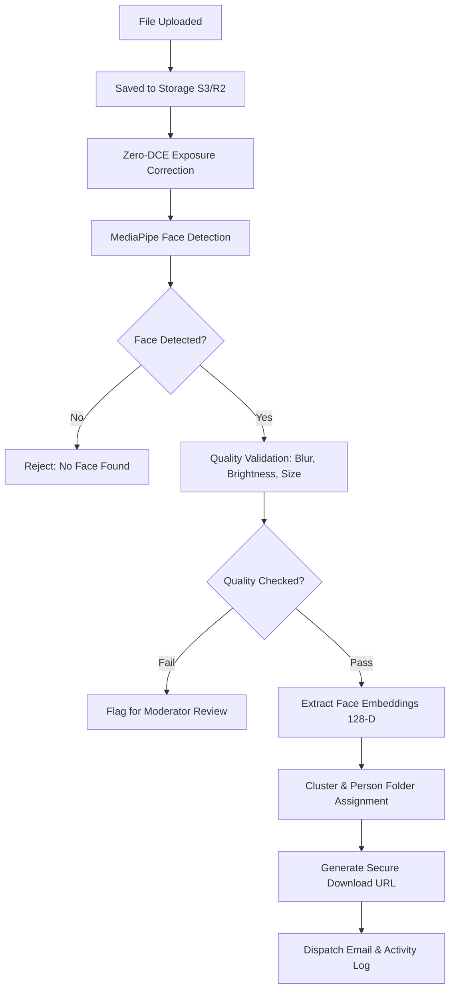

# FaceCloud — AI Facial Image Enhancement & Identity Organization Platform

FaceCloud is an AI-powered web application for enhancing, validating, organizing, and monitoring facial images. It allows users to upload images, process them through an AI pipeline, group detected faces into person folders, and download enhanced results. It also includes admin monitoring and moderator review workflows.

Powered by **DATAMART / DTM.IO**.

---

## 1. Project Overview

FaceCloud is designed to handle high-throughput and low-light facial photography, providing tools for both regular users, moderators, and system administrators. The key features of the platform include:
* **AI Facial Image Enhancement**: Automatically enhances exposure, contrast, and facial details on uploaded portraits.
* **Zero-DCE (Zero-Reference Deep Curve Estimation)**: Conceptually used for low-light enhancement without reference images, restoring details in dark zones.
* **Face Detection & Landmarks**: Uses on-device machine learning to locate faces and identify landmark coordinates.
* **Quality Validation**: Automatically checks images for quality criteria including brightness, blur, and face size ratio.
* **Person Folder Grouping (Identity Groups)**: Clusters detected face embeddings, mapping identical faces to unique person folders automatically.
* **Secure Downloads**: Generates time-limited download links for single images or complete batch reports.
* **Processing Jobs**: Monitored queues that track multi-stage backend operations in real-time.
* **Admin Monitoring**: Dashboards tracking user directory, security incidents, API endpoint test runners, and statistics.
* **Moderator Review**: A manual human-in-the-loop review queue for borderline or rejected images.
* **Mock Architecture**: The frontend is fully functional and uses LocalStorage/mock presets to simulate API responses.

---

## 2. Current Frontend Status

The frontend is being connected to the [Django backend](https://github.com/ijaz-student021/FaceCloud_backend) one screen at a time, controlled by `VITE_USE_API` in `.env.local`:

* **Live on the API:** sign-in; the moderator dashboard and review queue; and the user portal's single upload, processing view, uploads list, My Images gallery and image detail.
* **Still on mock data and `localStorage`:** the live webcam preview (browser filters; captured frames are enhanced by the real pipeline), the remaining moderator screens, and the admin console. Every other user-portal screen reads the live API when `VITE_USE_API=true`.

With `VITE_USE_API=false` (or no `VITE_API_URL`) every screen falls back to the built-in demo data, so the prototype stays fully browsable without a server running.

---

## 3. Tech Stack

The application relies on the following frontend dependencies (from [package.json](file:///Users/Ali/Downloads/FYP/package.json)):
* **Framework**: React (v19.2.7)
* **Build System & Dev Server**: Vite (v8.1.1)
* **Language**: TypeScript
* **Styling**: Tailwind CSS (v3.4.19)
* **Animation**: Framer Motion (v12.42.2)
* **Icons**: Lucide React
* **Data Visualization**: Recharts (v3.9.2)
* **Video Hero Stream**: hls.js (v1.6.16) for responsive video playback
* **On-Device Machine Learning**: `@mediapipe/tasks-vision` (v0.10.35) for browser webcam face detection
* **Routing**: React Router DOM (v7.18.1)
* **Mock State Management**: LocalStorage-backed mock session store

---

## 4. Design System / UI Theme

FaceCloud uses a **Cinematic Dark Liquid-Glass UI** aesthetic:
* **Background**: Pure dark palette (`#000000` primary background).
* **Glassmorphism**: Backdrop blur panels (`backdrop-filter: blur(24px)`) styled with subtle border stroke overlays (`rgba(249, 115, 22, 0.12)`).
* **Color Accents**: Premium orange brand accents (`#F97316` core accent, with `#EA580C` and `#FB923C` stops). Status colors (Emerald, Amber, Rose) are preserved for active success/warning/error states.
* **Typography**: Primary display headings (`h1`, `h2`, `h3`) utilize `Space Mono` (Google Fonts). Small numbered section indicators utilize `Silkscreen` (Google Fonts). Body copy continues using `Inter`.
* **Visual Effects**: Micro-animations on buttons and cards using Framer Motion, dynamic hover transitions, and pulse glows on status badges.
* **Landing Page**: The FaceCloud hero uses a seamless ping-pong playback sequence. The original CloudFront video plays forward, followed by a locally generated reversed MP4, avoiding the abrupt restart produced by native video looping. Features a "live systems" data-ops aesthetic with status badges, terminal-style logs, live pipeline cards, and animated percentage indicators.
* **Responsive Layouts**: Multi-device sidebars that automatically collapse on mobile screens with responsive top header bars.

### Landing Page Sections (in order)
1. **Fullscreen Video Hero** — CloudFront MP4 background video with seamless ping-pong forward/reverse loop and desktop mouse parallax, staggered headline animation with `<ScrambleText>` decodes and orange highlight blocks, inline email waitlist capture, pill badge pop-in.
2. **Trusted Logos Marquee** — Infinite horizontal scroll of partner logos.
3. **Stats / Metrics Bar** — 4 animated CountUp counters (detection accuracy, processing time, images processed, RBAC roles).
4. **01 / Early Access Feedback** — Testimonials block with orange hover border shadows.
5. **02 / Dataset Challenge (Problem Cards)** — 5 problem cards with staggered scroll reveal and icon pop animations.
6. **03 / Use Cases / Who It's For** — 4 cards: Identity Verification, Event Photography, HR & Onboarding, Enterprise Photo Archives.
7. **04 / AI Infrastructure** — Live-looping pipeline panel cycling PENDING → ACTIVE → SUCCESS status badges.
8. **05 / Ingestion Suite** — 12-card feature grid with staggered reveal and hover glow.
9. **06 / Methodology (Freedom Section)** — Responsive three-column layout with an HLS-hosted processing video, pain points list, and benefits list.
10. **07 / Interactive Demo** — Before/after slider with auto-demo scroll trigger (0→50%).
11. **08 / Processing Options** — Single, Multiple, ZIP upload cards.
12. **09 / Pricing** — Monthly/Yearly toggle, 3 tier cards (Free/Basic/Pro), each marked "Coming soon" with a disabled button — plans and pricing are deferred to V2.
13. **10 / User Interface** — 3 dashboard preview mockup cards.
14. **11 / Administrative Control** — Admin Console and Moderator Review cards with orange-colored hover glows.
15. **12 / Enterprise Security** — Security points grid + animated terminal log feed with typewriter effect.
16. **13 / FAQ** — Accordion with Framer Motion layout height animation.
17. **14 / API / Integrations Teaser** — Terminal-style code block showing example REST request.
18. **Final CTA** — Call to action with orange gradient orb background.
19. **Footer** — Logo, Product links (Features, Methodology, Pricing, Security, FAQ), Portals, Compliance.

### Public Marketing Pages
* **About Page (`/about`)**: Full-width marketing overview highlighting the product genesis and core mission:
  * **Hero Section**: Mission badge and first-person-plural story explaining *why* FaceCloud was built.
  * **Mission Statement**: Explains FaceCloud's approach to the Dataset Challenge.
  * **How We Work**: Three card-based value pillars (Automation with Control, Security, and Production-tested building in partnership with DataMart).
  * **The Team**: Styled profile card list displaying Ali Chaudhry, Maria F., and David S. with initials-based testimonials avatars.
* **Contact Page (`/contact`)**: Centered contact hub containing:
  - **Header**: Inline badge and workflow question subtext.
  - **Inquiry Form**: Interactive layout capturing Name, Email, optional Company, select inquiry Reason, and Message. Includes real-time validation, dynamic error labels, asynchronous submission status overlays (processing state, success state, retry error state), and console-logged JSON payload stub.
  - **Context Info Cards**: Displays general support email, enterprise partnerships channel, and quick FAQ anchor redirection back to the home page.

### Animation Utility Components
* [`RevealOnScroll`](file:///Users/Ali/Downloads/FYP/src/components/animation/RevealOnScroll.tsx) — `whileInView` scroll-triggered reveal with direction, delay, and `prefers-reduced-motion` support.
* [`StaggerChildren`](file:///Users/Ali/Downloads/FYP/src/components/animation/StaggerChildren.tsx) — Container + item wrapper for staggered child animations.
* [`CountUp`](file:///Users/Ali/Downloads/FYP/src/components/animation/CountUp.tsx) — Animated number counter with easeOutQuart easing, triggered on scroll.
* [`ScrambleText`](file:///Users/Ali/Downloads/FYP/src/components/animation/ScrambleText.tsx) — Animated scroll-to-view text scramble-and-decode component with custom frames duration and prefers-reduced-motion bypass support.

---

## 5. Authentication and Roles

The application protects routes based on user roles using a [ProtectedRoute](file:///Users/Ali/Downloads/FYP/src/components/layout/ProtectedRoute.tsx) guard checked against `localStorage`.

### Mock Credentials

| Role | Username | Password | Purpose |
| :--- | :--- | :--- | :--- |
| **User** | `user@facecloud.ai` | `password` | Uploading, managing images, viewing folders, and webcam live demo. |
| **Admin** | `admin@dtm.io` | `password` | Auditing logs, managing users, testing mock APIs, system health panels. |
| **Moderator** | `moderator@facecloud.ai` | `password` | Checking flagged images, reviewing rejection reasons, approving queues. |

### Auth System Architecture
* **User Login**: Simulates credentials verification and sets the `facecloud_session` JSON item in `localStorage`.
* **Verification Flow**: Localized mock verification redirects users to verify email screen before dashboard entry.
* **Route Protection**: If the session is missing, users are redirected back to the role-specific login. If roles mismatch, they are sent to `/unauthorized`.

---

## 6. Routes

The complete route configuration as specified in [App.tsx](file:///Users/Ali/Downloads/FYP/src/App.tsx):

### Public / Auth Routes
* `/` (Landing Page)
* `/about`, `/contact` (public pages)
* `/roles/moderator` (Moderator role guide — what the role can and cannot do, how a review works, build status; an information page, not the portal; linked from the navbar as "Moderator" and from the Moderator Review card on the landing page)
* `/login` (User Login)
* `/register` (User Registration — full name, email, password; creates a real pending account when `VITE_USE_API=true`)
* `/signup` (Redirects to `/register`)
* `/verify-email` (Email verification. With the API on it opens from the emailed link `/verify-email?registration_id=…&token=…`, confirms it with the backend, then sends the person to `/login`; the demo build keeps a mock button)
* `/forgot-password` (request a reset link by email; linked from all three sign-in pages)
* `/reset-password/:uid/:token` (the page the emailed reset link opens: choose a new password)
* `/admin/login` (Admin Console Login)
* `/moderator/login` (Moderator Panel Login)
* `/unauthorized` (Access Denied page)
* `*` (Not Found / 404 page)

### User Portal Routes (under `/dashboard`)
* `/dashboard` (User Dashboard Overview)
* `/dashboard/upload` (Upload Center Gateway)
* `/dashboard/upload/single` (Single Image Upload and AI comparison)
* `/dashboard/upload/multiple` (up to 150 photos in one batch, the steps it is going through, real per-photo verdicts, why the others were not accepted, an Enhancement section with "Enhance accepted photos", and Download Accepted as a ZIP)
* `/dashboard/upload/zip` (a ZIP up to 2 GB; the real processing steps while it runs; real counts; "Why some photos were not accepted" in plain words with the photos behind each reason; an Enhancement section that says how many accepted photos are enhanced and has "Enhance accepted photos"; Download Accepted Photos as a ZIP)
* `/dashboard/processing/:id` (Real-time single job processing tracker)
* `/dashboard/images` (My Images gallery; tick photos to group them by person or delete them)
* `/dashboard/images/:id` (Image Detail: the verdict and quality scores, an Enhanced version card with before/after, Enhance / Enhance again with a style and strength, Download, Edit photo, and Delete this photo)
* `/dashboard/images/:id/edit` (Photo editor on the live backend: server-rendered previews while the sliders move (brightness, contrast, shadows, highlights, saturation, warmth, sharpness, AI tools, blend), Auto fixes, Reset, Hold to compare, Save as a new full-size version, and the list of versions with Use / Download / Delete. Needs a finished enhancement; not part of the demo build)
* `/dashboard/groups` (Person Folders: with the API on, your real folders with a mosaic of their photos; the consent banner appears here when face grouping is off)
* `/dashboard/groups/:id` (one Person Folder: its photos, rename, Delete selected photos, Merge folder (move another folder's photos into this one), Download All / Download Selected as a ZIP, and a time-limited Secure Link to the whole folder's ZIP)
* `/dashboard/downloads` (real download history; a new line is added each time a file is downloaded; time-limited secure links for enhanced photos and Person Folder ZIPs; expired batch ZIPs can be prepared again)
* `/dashboard/notifications` (real notifications: mark read / mark all read, open, dismiss, paging; the top-bar bell shows the same unread count)
* `/dashboard/activity` (your real activity history, paged; picking a type chip or searching looks through your newest 500 events (the backend's window) and shows how many of each type there are, or says there are none)
* `/dashboard/settings` (name, organization, job title, phone, country and the picture saved to the account; password change; the list of signed-in devices with Revoke, and sign out of all devices; notification switches saved to the account. Against a backend that predates profile details/sessions (before backend PR #67) the extras and picture stay on this device and the device list is hidden)
* `/dashboard/live-enhancement` (webcam preview with face detection; a captured frame is stored in My Images and enhanced by the real pipeline with a chosen style and strength, real before/after and "what was done"; "Enhance again" re-enhances the same photo. The live preview itself uses simple browser filters. The demo build keeps the simulated version)
* `/dashboard/jobs` (Batch job history directory)

### Admin Console Routes (under `/admin`)
* `/admin` (Admin Overview metrics and telemetry)
* `/admin/users` (User directories, state controls, suspension logs)
* `/admin/audit-logs` (System activity logs and administrative audit traces)
* `/admin/security` (Risk alerts, failed logins monitor, IP blocking logs)
* `/admin/moderators` (list of moderator accounts, and a form to create one — `/admin/api-docs` and `/admin/api-test` were removed and redirect to `/admin`)
* `/admin/system` (Server instances CPU/RAM levels, service uptime statuses)
* `/admin/upload-statistics` (Upload volume charts and file sizes charts)
* `/admin/rejection-summary` (Quality-based rejection charts and metrics)
* `/admin/images` (Image surveillance stream and content logs)
* `/admin/logs` (Redirects to `/admin/audit-logs`)

### Moderator Routes (under `/moderator`)
* `/moderator` (Dashboard: overdue and due-soon counts against the review deadline, unassigned work, oldest waiting review, and per-moderator performance over a 7/30/90-day window)
* `/moderator/queue` (Review queue: the photo under review shown as a thumbnail, filters by status, source, assignment and overdue-only, deadline ordering, claim or release a review so two moderators cannot work the same photo, and bulk approve, reject or escalate)
* `/moderator/images/:id` (Human-in-the-loop audit detail view)
* `/moderator/audit` (Historical review log matching decisions to actors)
* `/moderator/settings` (Moderator interface threshold settings)

---

## 7. User Portal Features

* **Dashboard Overview**: Displays summary cards (enhanced count, quality rate, groups matched, download limits) and recent jobs history with system statuses.
* **Upload Center**: Gateway to route single, batch, or zip archives to target upload streams.
* **Single Image Upload**: Allows drag-and-drop of an image, runs a 13-stage simulated AI pipeline, and loads an interactive comparative before/after slider utilizing HTML5 Canvas filters.
* **Multiple Image Upload**: Processes collections of images concurrently in a progress queue, simulating details verification and face clusters.
* **ZIP Archive Upload**: Handles bulk assets in standard ZIP archives, reporting extraction speeds, valid image counts, and extraction progress logs.
* **Processing Jobs**: Detailed visual tracker containing duration metrics, stage completion ticks, and failure reasons for active tasks.
* **My Images Grid**: Comprehensive gallery with search/filters based on face count, blur scores, or dates.
* **Person Folders (Identity Groups)**: Groups matched face embeddings into specific cards displaying matched confidence rates and historical counts.
* **Secure Downloads**: Allows packaging enhanced copies, raw copies, or PDF audit reports to local browser filesystem downloads.
* **Activity Logs**: Auditing stream representing user actions such as login, enhancement, and downloads.

---

## 8. Live Enhancement

Located at `/dashboard/live-enhancement`, this feature leverages browser capabilities to simulate high-performance camera restoration:
* **Webcam Ingestion**: Connects to the browser camera media API. Users can select active capture resolution (supporting up to `1920×1080`).
* **Original Feed vs. AI Output**: Split tabs displaying side-by-side or individual camera feeds.
* **MediaPipe Face Detection**: Integrates `@mediapipe/tasks-vision` (BlazeFace model) running in the browser. It parses coordinates to draw green bounding boxes and face landmarks in real-time on the Original Feed. The AI Enhanced Output feed remains clean, showing the enhanced picture without overlays.
* **Real-time Filters**: Sliders adjusting brightness, contrast, saturation, detail recovery, and noise reduction apply filters on canvas overlays to mimic real-time GPU restoration.
* **Snapshot Pipeline**: A Remini-style capture button snaps the camera frame and runs it through the full 13-stage FaceCloud quality evaluation pipeline.
* **Reversion Note**: *Age/gender estimation was tested but removed/reverted because the model was not reliable enough for the current demo.*

---

## 9. Upload Pipeline

When files are uploaded via the portal, they undergo an automatic multi-stage validation sequence:



### Key Business Rule for Face Processing
> [!IMPORTANT]
> **Multi-Face Rule:**
> Multi-face images are **not** rejected by default. The intended backend behavior is to enhance the image and attach the resulting file link to **every** matched person folder.

---

## 10. Admin Console Features

* **System Telemetry**: Displays RAM, CPU, database load, and active job queues across servers.
* **User Accounts Controls**: System operators can search users, inspect account upload quotas, and trigger status updates (e.g., active, suspended).
* **Live Audit Traces**: Shows audit logs detailing actors, roles, actions, resource targets, and source IP addresses.
* **Security Monitoring**: Displays risk status graphs, failed logins, and suspicious API rate-limit alerts.
* **Interactive API Playground**: Includes Swagger-styled REST details for `/api/auth/login`, `/api/user/images`, and others. Operators can hit "Send Request" to trigger simulation triggers and verify responses.
* **Upload and Quality Statistics**: Incorporates Recharts charts demonstrating upload volumes, resolution distributions, and quality rejection categories.

---

## 11. Moderator Panel Features

* **Review Queue**: Lists borderline files flagged by the quality validation step (e.g., high blur, low brightness, poor face-size ratio).
* **Human-in-the-Loop Audit Card**: Allows moderators to view the raw image, quality scores, face boundaries, and choose to **Approve** (forces override index and maps to person folders) or **Reject** (logs reason and removes from active database indexes).
* **Moderation Audit Log**: Tracks decision archives linking moderator accounts to approved or rejected items.

---

## 12. Mock Data

The mock datasets and schema typescript interfaces are stored in:
* [mock.ts](file:///Users/Ali/Downloads/FYP/src/data/mock.ts) (contains types for `ImageRecord`, `PersonFolder`, `ProcessingJob`, `SystemService`, `ReviewItem`, and `ApiEndpoint` along with initial mock state data).

All dashboard actions interact with temporary mock databases or `localStorage` schemas. These mocks are built to match standard JSON REST replies, making it straightforward to connect to actual HTTP endpoints later.

---

## 13. Backend Roadmap Summary

To transition this project into a production-grade application, a microservices backend is required.

### Required Backend Modules
1. **Auth Module**: JWT token emission, bcrypt password hashing, 2FA, email confirmation queues.
2. **Upload & Media Storage**: S3/R2 cloud storage buckets with pre-signed upload URLs and CDN cache proxies.
3. **Queue Manager**: Redis-backed message broker (e.g., BullMQ) to distribute processing workloads.
4. **AI Processing Workers**: Independent GPU-accelerated python instances processing image files.
5. **Quality & Validation**: Image processing scripts evaluating sharpness, lighting levels, and face bounding coordinates.
6. **Face Biometrics API**: Embedding extractor calculating similarity distances for database clustering.

### Suggested Backend Stack
* **API Service**: Node.js + TypeScript + NestJS / Express
* **Database**: **PostgreSQL** (relational storage for users, jobs, logs) + **Prisma ORM** ✅ Selected
* **Work Queue**: Redis + BullMQ (asynchronous job tracking)
* **Storage**: AWS S3 / Cloudflare R2
* **AI Worker Service**: Python + FastAPI
* **Deployment**: Frontend is uploaded to Hostinger as a static build; SPA routing comes from `public/.htaccess`. The Django backend is not deployed yet and runs locally.

> [!NOTE]
> **Supabase MCP is NOT required.** Local development uses Docker PostgreSQL (`docker-compose.yml`). Prisma handles all schema migrations and database access.

### Production AI Models
* **Zero-DCE**: Real-time low-light restoration.
* **GFPGAN / CodeFormer**: Blind face restoration and detail recovery.
* **Real-ESRGAN**: High-resolution image upscaling.
* **InsightFace**: Facial recognition and 128-D vector embeddings mapping.
* **MediaPipe**: Fast CPU-based face detection and landmarks mapping.

---

## 14. Installation and Local Development

### Frontend Setup

#### Prerequisites
* **Node.js** (v18.x or higher recommended)
* **npm** or **yarn**

#### Steps
1. **Clone the repository** and navigate to the project directory:
   ```bash
   cd fyp
   ```
2. **Install dependencies**:
   ```bash
   npm install
   ```
3. **Start the development server**:
   ```bash
   npm run dev
   ```
   The local application will launch on:
   ```txt
   http://localhost:5173
   ```
4. **Compile and test the production build**:
   ```bash
   npm run build
   ```
5. **Preview the production bundle locally**:
   ```bash
   npm run preview
   ```

---

## 15. Backend

The backend is a separate Django project:
**https://github.com/ijaz-student021/FaceCloud_backend**

It is a REST API (Django 6 + DRF, PostgreSQL, Celery, Redis) with 175 endpoints,
JWT authentication with optional two-factor, organizations and moderation,
and an OpenAPI schema served at `/api/docs/`. Its own README covers setup.

This repository is the browser application only. It talks to that API over HTTP
and never touches a database, so there is no ORM, schema or migration here.

> [!NOTE]
> An earlier `backend/` folder in this repository held a parallel Prisma schema
> drafted before the Django backend existed. It was never an API — only a schema
> and a seed script — and its models disagreed with the ones actually in use. It
> was removed on 2026-10-02; see `WORK_LOG.md`.

### Pointing the frontend at it

```bash
cp .env.example .env
```

| Variable | Meaning |
|:---------|:--------|
| `VITE_API_URL` | Backend origin, no trailing slash. `http://127.0.0.1:8000` for a local backend |
| `VITE_USE_API` | `true` to call the API; anything else keeps the built-in mock data |

The flag exists so screens can be migrated one at a time: with `VITE_USE_API`
unset the demo dashboard stays populated, and each screen switches over as its
API calls are written. The sign-in screen is wired; the rest still read
`src/data/mock.ts`.

The backend only accepts browser requests from the origins listed in its
`CORS_ALLOWED_ORIGINS`, so add this app's origin there before testing against a
deployed backend.

## 16. Deployment

* **Live host**: `facecloudai.com` is served from **Hostinger** (Apache/LiteSpeed). Deployment is a manual upload of
  the `dist/` folder to the web root.
* **SPA Routing Configuration**: React Router owns every path, so the server must return `index.html` for any route
  that is not a real file. Two config files cover this, and both are built from `public/`:
  * `public/.htaccess` — the one that matters for the live site. It ships inside `dist/` on every build.

> [!WARNING]
> **Build the hosting copy as the demo, not with your local settings.** `.env.local` (which points at `http://127.0.0.1:8000` and turns the API on)
> is read by every `npm run build` on your own machine, so a build made there carries that address and every visitor's browser would try to
> reach *their* localhost. Build it with the settings overridden:
> `VITE_USE_API=false VITE_API_URL= npm run build`, and check that `grep -c "127.0.0.1:8000" dist/assets/index-*.js` prints `0`
> before uploading. (A build made from a clean checkout, which has no `.env.local`, is safe too.)

> [!IMPORTANT]
> **`.htaccess` is a hidden file.** Most file managers and FTP clients do not show names beginning with a dot, so it
> is easy to upload `dist/` without it. If it is missing from the web root, every deep link (`/admin`, `/dashboard`,
> `/login`) returns the host's own 404 page — the app only works from `/`. Turn on "show hidden files" before
> uploading, and check the web root afterwards.

---

## 17. Known Limitations

* **No Server Persistence**: Data created during a browser session (uploaded photos, logs, changes) is stored in local memory or `localStorage`. Refreshing or clearing storage resets the mock data.
* **Client-Side Simulation**: Image filter outputs use browser canvas contexts (`ctx.filter`) rather than deep-learning GPU model logic.
* **Webcam Performance**: The real-time face tracker depends on client CPU capabilities. Frame rates may degrade on older hardware with multiple background tasks.
* **No Real Emails**: Email notification events are logged to the dashboard database but do not send actual SMTP emails.

---

## 18. Future Work

* **API Integration**: Swap local mock data services for Axios/Fetch clients communicating with the Node.js API Gateway.
* **Database Integration**: Connect the client to a PostgreSQL database via backend endpoints to persist uploaded files and jobs permanently.
* **Storage Service Link**: Bind the upload forms to upload direct binaries to storage buckets.
* **PyTorch AI workers**: Route jobs in the Redis queue to Python workers running GFPGAN/CodeFormer models.
* **Unit & E2E Testing**: Add Jest unit tests and Playwright integration pipelines.
* **Accessibility (a11y)**: Audit focus indicators, keyboard bindings, and ARIA labels.

---

## 20. Branding

FaceCloud utilizes a dark luxury, premium branding style built around the official FaceCloud logo:

* **Official FaceCloud Logo**: Represents the single source of truth for the platform's visual identity.
  * Location: [facecloud-logo-original.png](file:///Users/Ali/Downloads/FYP/public/branding/facecloud-logo-original.png)
* **Logo Variants**: Available under `public/branding/` for different UI surface areas:
  * `facecloud-logo-full.png`: Full version with electric blue cloud, metallic silver FC insignia, human face profile, neural-network nodes, wordmark, and subtitle. Used on login pages.
  * `facecloud-logo-horizontal.png`: Horizontal layout optimized for sidebars and top navigation bars.
  * `facecloud-logo-icon.png`: Icon-only variant for collapsed layouts and avatar elements.
  * `facecloud-wordmark.png`: Text-only wordmark.
  * `facecloud-logo-dark.png` / `facecloud-logo-light.png`: Dark/light background variants.
* **Favicon Assets**: Optimized icon-only favicons in multiple resolutions (`16x16`, `32x32`, `48x48`, `192x192`, `512x512`) and `facecloud-apple-touch-icon.png`.
* **Design Integration**: Rendered exclusively via the reusable `FaceCloudLogo` component (`src/components/branding/FaceCloudLogo.tsx`).
* **Brand Colors**:
  * Electric Blue: `#168BFF`
  * Bright Blue: `#42A5FF`
  * Deep Blue: `#0758D8`
  * Metallic Silver: `#C9D2E3`
  * Off-white: `#F5F8FF`
  * Deep Black/Navy: `#030712` / `#07101F`
* **DATAMART Relationship**: FaceCloud is powered by **DATAMART / DTM.IO**. Datamart is kept as secondary text to maintain FaceCloud as the primary user-facing brand.

> [!IMPORTANT]
> **Branding Rule:**
> The official FaceCloud logo must be used across all public, user, admin, and moderator interfaces. Do not use temporary icons, text-only placeholders, generic cloud marks, or alternative FaceCloud logos. All application layouts must use the reusable `FaceCloudLogo` component and assets from `public/branding/`.

---

## 21. Interactive Demo

The Interactive Demo uses a locally stored facial image with frontend visual filters to demonstrate the intended original-versus-enhanced experience until the production FaceCloud AI processing service is connected.

* **Demo Image Asset Path**: [facecloud-enhancement-demo-original.jpg](file:///Users/Ali/Downloads/FYP/public/demo/facecloud-enhancement-demo-original.jpg)
* **Visual Filters**:
  * Original (Before): `filter: brightness(0.72) contrast(0.88) saturate(0.84)`
  * AI Enhanced (After): `filter: brightness(1.08) contrast(1.08) saturate(1.03)`

---

## 22. Development Rule

> [!IMPORTANT]
> **Core Development Workflow:**
> After completing every major feature, bug fix, route change, or UI update:
> 1. Run `npm run build`
> 2. Resolve all compilation and linting errors.
> 3. Update the `README.md` file to document new features or modifications, and add a dated entry to `WORK_LOG.md` (the running work log, Section 2).
> 4. Commit changes with a descriptive, concise message.
> 5. Push to the `origin main` branch.
> 
> **Do not leave the README outdated. It must always reflect the current status of the codebase.**
