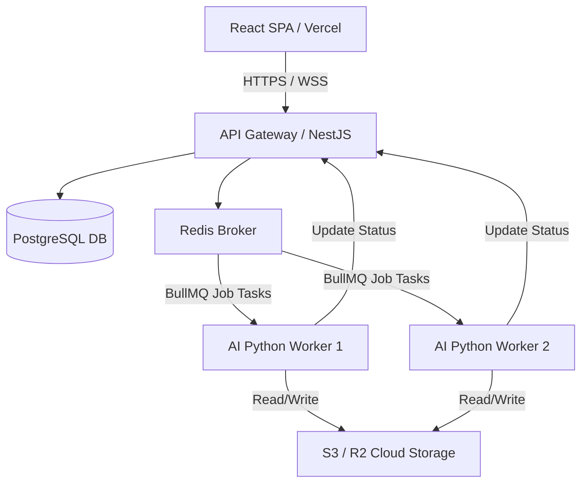

# FaceCloud — Backend Architecture & Development Roadmap

This document serves as the technical blueprints and implementation roadmap for building the production-ready microservices backend for FaceCloud. It covers system architecture, database schemas, REST APIs, task queues, and AI/deep learning model deployment.

> [!IMPORTANT]
> **Technology Decision — Database Setup:**
> - ✅ **PostgreSQL** is the selected primary database for FaceCloud.
> - ✅ **Prisma ORM** is used for all schema definitions, migrations, and database access.
> - ✅ **Docker Compose** (`docker-compose.yml`) provides local PostgreSQL 16 + Redis 7 for development.
> - ❌ **Supabase MCP is NOT required** and should NOT be used. Use the Docker PostgreSQL setup instead.
> - See [README.md § 15. Backend Database Setup](./README.md) for step-by-step local setup instructions.

---

## 1. System Architecture

To support high-throughput image processing, real-time webcam telemetry, and automated identity clustering, FaceCloud uses a decoupled microservices design:



### Architectural Components
1. **Frontend Client**: React Single Page Application deployed to Vercel/Netlify.
2. **API Gateway / Core Backend**: Built on Node.js + TypeScript + NestJS. Handles HTTP routing, user session state, database synchronization, secure URL signing, and task queue triggers.
3. **Task Queue Broker**: Redis instances orchestrating job prioritization and execution tracking via **BullMQ**.
4. **AI Processing Workers**: Python (FastAPI/PyTorch) worker daemons running on GPU-backed instances (e.g., AWS EC2 G4dn or RunPod).
5. **Asset Storage**: Cloudflare R2 or AWS S3 buckets for storing raw and enhanced images.
6. **Relational Database**: PostgreSQL hosting structured records (users, images, jobs, logs, audit reports).

---

## 2. Database Schema (PostgreSQL & Prisma)

Below is the proposed database schema written in Prisma schema syntax.

**Implementation Status:**
- ✅ Schema implemented in `backend/prisma/schema.prisma`
- ✅ All 15 models defined (see schema file for full implementation)
- ✅ Seed data available via `npm run seed` inside `backend/`
- ✅ Local DB: Docker PostgreSQL (`docker compose up -d`)
- ❌ Supabase MCP not required — do not use it

The schema below is the roadmap reference. The actual implementation in `backend/prisma/schema.prisma` includes additional models:
`sessions`, `uploads`, `detected_faces`, `image_quality_checks`, `face_embeddings`,
`person_folders`, `person_folder_images`, `processing_steps`, `notifications`, `activity_logs`, `admin_audit_logs`.

```prisma
datasource db {
  provider = "postgresql"
  url      = env("DATABASE_URL")
}

generator client {
  provider = "prisma-client-js"
}

enum Role {
  USER
  ADMIN
  MODERATOR
}

enum Status {
  ACTIVE
  SUSPENDED
}

enum JobStatus {
  PENDING
  PROCESSING
  COMPLETED
  FAILED
  REJECTED
}

enum QualityStatus {
  PASSED
  FAILED
}

model User {
  id           String        @id @default(uuid())
  name         String
  email        String        @unique
  passwordHash String
  role         Role          @default(USER)
  status       Status        @default(ACTIVE)
  createdAt    DateTime      @default(now())
  updatedAt    DateTime      @updatedAt
  images       ImageRecord[]
  jobs         Job[]
  downloads    Download[]
  auditLogs    AuditLog[]
}

model ImageRecord {
  id                  String             @id @default(uuid())
  filename            String
  rawUrl              String             // S3/R2 path to raw image
  enhancedUrl         String?            // S3/R2 path to enhanced image
  faceDetected        Boolean            @default(false)
  faceCount           Int                @default(0)
  blurScore           Float              // 0-100 quality metric
  brightnessScore     Float              // 0-100 quality metric
  faceSizeScore       Float              // 0-100 quality metric
  qualityStatus       QualityStatus
  rejectionReason     String?
  matchedConfidence   Float?             // Percentage similarity
  uploadedAt          DateTime           @default(now())
  
  userId              String
  user                User               @relation(fields: [userId], references: [id], onDelete: Cascade)
  
  groupId             String?
  group               IdentityGroup?     @relation(fields: [groupId], references: [id])
  
  moderatorReviews    ModeratorReview[]
}

model IdentityGroup {
  id                 String        @id @default(uuid())
  label              String        // e.g. "Person Folder #3"
  createdAt          DateTime      @default(now())
  updatedAt          DateTime      @updatedAt
  images             ImageRecord[]
}

model Job {
  id            String       @id @default(uuid())
  filename      String
  status        JobStatus    @default(PENDING)
  uploadType    String       // "Single" | "Multiple" | "ZIP"
  progress      Int          @default(0)
  createdAt     DateTime     @default(now())
  updatedAt     DateTime     @updatedAt
  failureReason String?
  
  userId        String
  user          User         @relation(fields: [userId], references: [id], onDelete: Cascade)
}

model Download {
  id           String    @id @default(uuid())
  name         String
  type         String    // "single" | "batch" | "report"
  size         String
  downloadedAt DateTime  @default(now())
  expiryDate   DateTime
  secureLink   String
  
  userId       String
  user         User      @relation(fields: [userId], references: [id], onDelete: Cascade)
}

model AuditLog {
  id        String   @id @default(uuid())
  action    String
  resource  String
  ip        String
  details   String?
  createdAt DateTime @default(now())
  
  userId    String
  user      User     @relation(fields: [userId], references: [id], onDelete: Cascade)
}

model ModeratorReview {
  id          String      @id @default(uuid())
  status      String      // "PENDING" | "APPROVED" | "REJECTED"
  riskLevel   String      // "LOW" | "MEDIUM" | "HIGH" | "CRITICAL"
  feedback    String?
  createdAt   DateTime    @default(now())
  
  imageId     String
  image       ImageRecord @relation(fields: [imageId], references: [id], onDelete: Cascade)
}
```

---

## 3. REST API Endpoints Roadmap

All API endpoints should enforce JSON payloads and secure communication over HTTPS.

### 3.1 Authentication (`/api/auth`)
* `POST /api/auth/register` — Create user account. Fires off registration email queues.
* `POST /api/auth/login` — Sign in user, validates password, issues JWT access and refresh cookies.
* `POST /api/auth/verify-email` — Confirms validation tokens sent via verification emails.
* `POST /api/auth/refresh` — Rotates access JWT tokens using http-only refresh cookies.

### 3.2 User Portal (`/api/user`)
* `GET /api/user/profile` — Fetch session statistics (enhanced images, folder counts).
* `POST /api/user/upload/presign` — Requests pre-signed storage URLs for client-to-bucket direct file streams.
* `POST /api/user/jobs` — Creates a new async processing job (Single, Batch, or ZIP).
* `GET /api/user/jobs/:id` — Polling route checking progress updates on task stages.
* `GET /api/user/images` — Fetches current user's image collection (search & filter query strings support).
* `GET /api/user/groups` — Fetches matching face folder directory collections.
* `POST /api/user/downloads/package` — Triggers backend bundling of ZIP reports for download.

### 3.3 Admin Console (`/api/admin`)
* `GET /api/admin/users` — Fetch system user list.
* `PATCH /api/admin/users/:id` — Update user permissions or suspension settings.
* `GET /api/admin/system/metrics` — Read current instance loads, Redis queue sizes, and database connections count.
* `GET /api/admin/audit-logs` — Retreive system administrative actions.
* `GET /api/admin/analytics/uploads` — Get historical aggregates grouped by dates/sizes.

### 3.4 Moderator Queue (`/api/moderator`)
* `GET /api/moderator/queue` — Fetch flagged images.
* `POST /api/moderator/review/:id` — Approve (overrides failure scores) or Reject (removes indices).

---

## 4. Processing Pipeline Flow

When an image job is published to Redis:

1. **Ingest Phase**: Worker reads job meta, downloads source file from S3/R2 storage.
2. **Zero-DCE Phase**: Runs exposure curve estimation matrix to map dark pixels to optimal contrast levels.
3. **Face Detection**: MediaPipe / OpenCV locates boundaries.
   * If `faceCount == 0`: Flag status `REJECTED`, reason: `"No faces detected in upload."`
   * If `faceCount > 0`: Continue.
4. **Quality Metrics**: Calculate sharpness (Laplacian variance), exposure (mean luminosity), and face bounding-box ratios.
   * If thresholds fail: Flag status `PENDING_REVIEW`, send item to Moderator Queue.
   * If thresholds pass: Continue.
5. **Feature Embeddings**: InsightFace generates a 128-D vector mapping.
6. **Folder Clustering**: Calculates Euclidean distance against existing cluster indexes in DB.
   * If similarity > `0.75`: Map image to matching `IdentityGroup`.
   * If similarity <= `0.75` and multiple faces exist: **Map image to all matching group files**.
   * If no matches: Create a new `IdentityGroup`.
7. **Storage**: Write final enhanced copy to S3, generate time-locked CDN links, dispatch socket notifications to user.

---

## 5. Production AI Models Stack

For optimal restoration quality, Python workers should package the following models:
* **Zero-DCE (Deep Curve Estimation)**: Fast convolutional network trained for exposure restoration. Highly efficient on CPU/GPU.
* **GFPGAN (Generative Facial Prior GAN)**: Multi-stage blind face restoration. Recovers authentic facial textures, eyes, and teeth from highly degraded low-res images.
* **CodeFormer**: Transformer-based face restoration model. Excels at extreme blur degradation recovery.
* **InsightFace**: Deep learning face analysis toolbox. Utilizes ArcFace loss functions to generate highly precise 128-D vector embeddings for matching.
* **MediaPipe Tasks Vision**: Employed on the gateway/client for fast, lightweight coordinates capture.

---

## 6. Security and Compliance

* **Access Control**: All routes require validation of cookies containing HS256-signed JWTs. Roles are validated at gateway endpoints.
* **Rate Limiting**: Standard API keys require strict limit configurations (e.g., maximum 100 uploads/hour/user).
* **Binary Sanitization**: Validation of files on upload endpoints (restricting to `.jpg`, `.jpeg`, `.png`, `.zip` with mime-type checking). Maximum limits set to 10MB/image, 200MB/ZIP.
* **IP Trace Auditing**: Every admin config edit, user permission toggle, and download creation registers actor IP addresses to immutable logs.
